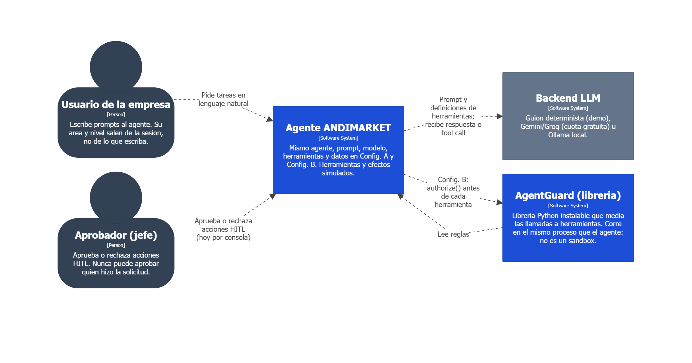
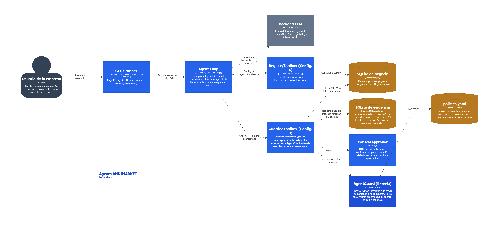
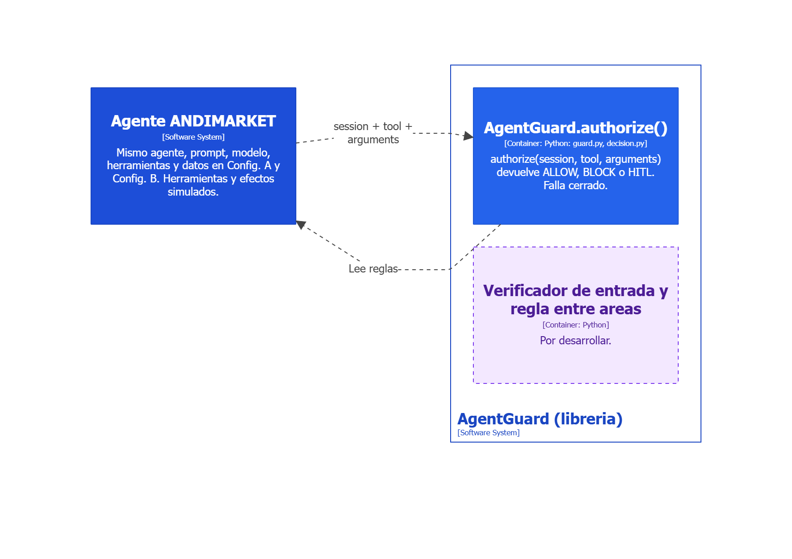
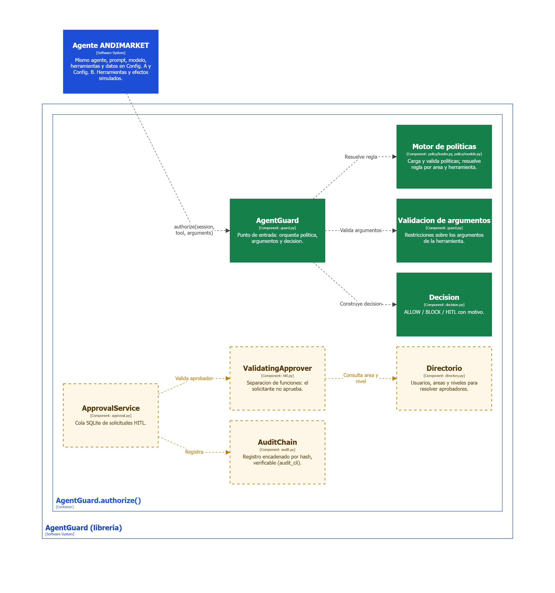

# 📄 Arquitectura del Sistema (modelo C4)

## 1. Sistema

* Nombre del sistema: **AgentGuard** (librería de control de acceso para agentes de IA), evaluada con el agente de **ANDIMARKET S.A.S.** (empresa ficticia de comercio electrónico).
* Objetivo: El sistema tiene como objetivo aplicar **mínimo privilegio** a las llamadas a herramientas de un agente LLM: antes de ejecutar cada herramienta decide si la **permite (ALLOW)**, la **bloquea (BLOCK)** o la **escala a aprobación humana (HITL)**, según el área y el nivel de la sesión, la herramienta y sus argumentos.

## 2. Problema a resolver

Un agente de IA con herramientas y permisos amplios ejecuta lo que el modelo decida. Si el modelo se equivoca o es manipulado (prompt injection), nada contiene el daño: puede borrar pedidos, enviar datos a un destinatario externo o ejecutar acciones administrativas. El riesgo crece cuando el mismo agente atiende a varias áreas de una organización sin distinguir qué le corresponde a cada una.

La comparación experimental usa el **mismo agente** en dos configuraciones: **Config. A** (ejecuta las herramientas sin control) y **Config. B** (cada llamada pasa por AgentGuard). La diferencia entre ambas es la mediación de AgentGuard.

## 3. Diagrama de Contexto (C4, nivel 1)

### 3.1 Diagrama



Vista `Nivel1_Contexto` del modelo en Structurizr (ver sección 8).

### 3.2 Actores

| Actor / Rol | Descripción |
|---|:---|
| Usuario de la empresa | Persona que escribe prompts al agente. Su **área y nivel salen de la sesión**, no de lo que escriba. |
| Aprobador (jefe) | Aprueba o rechaza las acciones que AgentGuard escala (HITL). **Nunca puede aprobar quien hizo la solicitud** (separación de funciones). Hoy aprueba por consola. |

### 3.3 Sistemas externos

| Sistema | Descripción |
|---|:---|
| Backend LLM | Modelo que devuelve respuestas o llamadas a herramientas. Guion determinista (demo y corridas reproducibles), Gemini o Groq (cuota gratuita) u Ollama local. |
| AgentGuard (librería) | Librería Python instalable que media las llamadas a herramientas. Corre en el mismo proceso que el agente. Se modela como sistema aparte porque es el producto; el agente de ANDIMARKET es su caso de validación. |

## 4. Alcance del sistema

### 4.1 Dentro del sistema

* Decidir **ALLOW, BLOCK o HITL** para cada llamada a una herramienta, según área, nivel, herramienta y argumentos (`AgentGuard.authorize(session, tool, arguments)`).
* **Validar la política al iniciar**: una política inválida impide ejecutar herramientas.
* **Fallar cerrado**: si no se puede decidir o registrar, la herramienta no se ejecuta.
* **Registrar la decisión** en SQLite antes de ejecutar (integrado en la demo, Config. B).
* Pedir **aprobación humana** para las acciones escaladas (hoy por consola en la demo).
* Obtener la identidad **de la sesión**, nunca de los argumentos que escribe el modelo.

### 4.2 Fuera del sistema

* **No es un sandbox ni una frontera de aislamiento**: corre en el mismo proceso que el agente.
* **No filtra el contenido del prompt**: el verificador de entrada y la regla de acceso entre áreas están **planeados**, no implementados.
* **No se integra con servicios empresariales reales**: las herramientas y sus efectos son simulados (datos sintéticos en SQLite); no hay identidad, correo ni bases de datos de producción.
* **No incluye todavía** la API (FastAPI), el frontend (React) ni la bandeja web de aprobaciones.
* **No está listo para producción**: requeriría una evaluación adicional de seguridad, despliegue, identidad, persistencia y operación.

## 5. Diagrama de contenedores (C4, nivel 2)

### 5.1 Diagrama



Vista `Nivel2_Contenedores_ANDIMARKET`. La Config. A llega a las herramientas **directamente**; la Config. B pasa por `GuardedToolbox` y `AgentGuard.authorize()`.



Vista `Nivel2_Contenedores_AgentGuard`: la librería y quién la llama.

### 5.2 Contenedores

| Contenedor | Tecnología / archivo | Responsabilidad |
|---|---|---|
| CLI / runner | Python: `config_a.py`, `config_b.py`, `session.py` | Elige Config. A o B y crea la sesión (usuario, área, nivel). |
| Agent Loop | Python: `agent/loop.py` | Envía el prompt y las definiciones de herramientas al modelo; ejecuta las llamadas que este devuelve. |
| RegistryToolbox (Config. A) | Python: `toolbox.py` | Ejecuta la herramienta directamente, sin autorización. |
| GuardedToolbox (Config. B) | Python: `toolbox_guard.py` | Intercepta cada llamada y pide autorización a AgentGuard antes de ejecutar **la misma** herramienta. |
| SQLite de negocio | SQLite | Clientes, pedidos, pagos y configuración de TI (simulados). |
| SQLite de evidencia | SQLite: `auditoria.py` | Decisiones y efectos de la Config. B, guardados **antes** de ejecutar. Sin cadena de hashes. |
| `policies.yaml` | YAML | Reglas por área, herramienta y argumentos. Se valida al iniciar. |
| ConsoleApprover | Python | HITL de la demo: confirmación por consola; por defecto rechaza en corridas reproducibles. |
| AgentGuard.authorize() | Python: `guard.py`, `decision.py` | Punto de entrada de la librería (ver sección 6). |

## 6. Diagrama de componentes (C4, nivel 3)

### 6.1 Diagrama



Vista `Nivel3_Componentes`. **Sólido verde = integrado en la demo. Punteado ámbar = existe en el núcleo (`agentguard-core`) pero no está conectado al flujo vivo.**

### 6.2 Componentes

| Componente | Archivo | Estado | Responsabilidad |
|---|---|---|---|
| AgentGuard | `guard.py` | Integrado | Punto de entrada: orquesta política, argumentos y decisión. |
| Motor de políticas | `policy/loader.py`, `policy/models.py` | Integrado | Carga y valida políticas; resuelve la regla por área y herramienta. |
| Validación de argumentos | `guard.py` | Integrado | Restricciones sobre los argumentos de la herramienta. |
| Decisión | `decision.py` | Integrado | ALLOW / BLOCK / HITL con motivo. |
| ApprovalService | `approval.py` | Núcleo, sin integrar | Cola SQLite de solicitudes HITL. |
| ValidatingApprover | `hitl.py` | Núcleo, sin integrar | Separación de funciones: el solicitante no aprueba. |
| Directorio | `directory.py` | Núcleo, sin integrar | Usuarios, áreas y niveles para resolver aprobadores. |
| AuditChain | `audit.py` | Núcleo, sin integrar | Registro encadenado por hash, verificable (`audit_cli`). |

## 7. Estado de implementación

| Estado | Elementos |
|---|---|
| **Integrado en la demo** | `authorize()`, motor de políticas, validación de argumentos, decisión, aprobación por consola y registro de la decisión en SQLite antes de ejecutar. |
| **Implementado en el núcleo, sin integrar** | `ApprovalService`, `ValidatingApprover`, `Directorio`, `AuditChain`. |
| **Planeado** | Verificador de entrada, regla de acceso entre áreas, API (FastAPI), frontend (React), login y bandeja web de aprobaciones. |

> Este estado se verificó contra la documentación del proyecto al 22 de octubre de 2026. Vuelve a inspeccionar el código antes de afirmarlo en un entregable: puede cambiar.

## 8. Código fuente de los diagramas

Los diagramas se generan **a partir del código**, no se dibujan a mano. El modelo está escrito en el DSL de [Structurizr](https://structurizr.com/) y las imágenes, el PlantUML y el Mermaid se derivan de él.

| Qué | Dónde |
|---|---|
| **Modelo C4 (fuente de verdad)** | [`codigo/structurizr/workspace.dsl`](codigo/structurizr/workspace.dsl) |
| PlantUML generado (una vista por archivo) | [`codigo/plantuml/`](codigo/plantuml/) |
| Mermaid generado | [`codigo/mermaid/`](codigo/mermaid/) |
| Imágenes (PNG, fondo blanco) | [`imagenes/`](imagenes/) |

Vistas del modelo: `Nivel1_Contexto`, `Nivel2_Contenedores_ANDIMARKET`, `Nivel2_Contenedores_AgentGuard` y `Nivel3_Componentes`.

> Si editas el modelo, cambia `codigo/structurizr/workspace.dsl`, vuelve a exportar el código y las imágenes (sección 8.1) y súbelos juntos.

### 8.1 Cómo regenerar

Desde `docs/arquitectura/codigo/structurizr/`, con Docker:

```bash
docker run -it --rm -p 8080:8080 -v "$(pwd):/usr/local/structurizr" structurizr/structurizr local
```

Abre `http://localhost:8080`. Las vistas están en `http://localhost:8080/workspace/1/diagrams`.

Validar el DSL y exportar el código:

```bash
docker run --rm -v "$(pwd):/usr/local/structurizr" structurizr/structurizr validate -workspace /usr/local/structurizr/workspace.dsl
docker run --rm -v "$(pwd):/usr/local/structurizr:ro" -v "$(pwd)/../plantuml:/out" structurizr/structurizr export -w /usr/local/structurizr/workspace.dsl -f plantuml -o /out
docker run --rm -v "$(pwd):/usr/local/structurizr:ro" -v "$(pwd)/../mermaid:/out" structurizr/structurizr export -w /usr/local/structurizr/workspace.dsl -f mermaid -o /out
```

Esta versión de Structurizr **no exporta PNG por línea de comandos**. Las imágenes se exportan desde el navegador, en la página de cada vista, con el botón de exportar diagrama (conviene el **modo claro** del selector sol/luna de la barra lateral).

### 8.2 Notas de la versión

* Versión usada: Structurizr v2026.09.19 (imagen `structurizr/structurizr` en Docker).
* Los textos del modelo van **sin tildes** a propósito, para evitar problemas de codificación entre herramientas.
